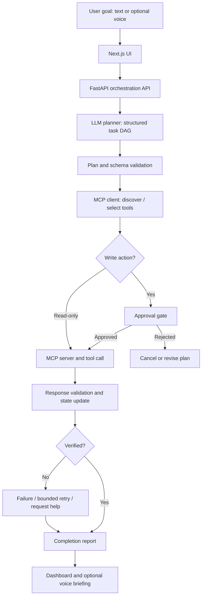

# TASKZERO — Proposed Architecture

> Concept architecture for the ideathon. Components and integrations are planned, not implemented.

## Component layers
1. **User interface & voice layer** — Next.js web console for task input, plan preview, status, approval, and report; optional voice interface.
2. **Backend orchestration** — FastAPI controller manages sessions, task states, approvals, timeouts, and execution coordination.
3. **AI planning engine** — Interprets the goal, decomposes it into dependent steps, produces a structured plan, and maps steps to available tool schemas.
4. **MCP client** — Connects to compatible MCP servers, discovers tools, and invokes selected tools through the MCP protocol.
5. **MCP servers / tools** — Proposed calendar and filesystem/notes tools for a focused meeting-coordination demo.
6. **State and validation** — SQLite for durable execution state; Pydantic for validating plan and response schemas.
7. **Verification and reporting** — Validates tool-returned evidence, updates statuses, and generates a final summary; optional ElevenLabs TTS.

## Data flow

## Proposed boundaries
- The planner proposes actions; it does not directly perform external writes.
- The orchestration layer enforces state transitions and approval policy.
- MCP is the tool-connectivity interface, not the planner or approval system.
- Each action should carry a tool name, validated arguments, expected result, and risk/approval requirement.
- Verification should use tool response data and appropriate checks, not an LLM's assertion alone.

## Planned execution states
`PENDING → PLANNED → WAITING_APPROVAL → APPROVED → RUNNING → VERIFIED`

Terminal or alternate states: `REJECTED`, `FAILED`, `CANCELLED`, `NEEDS_INPUT`.
